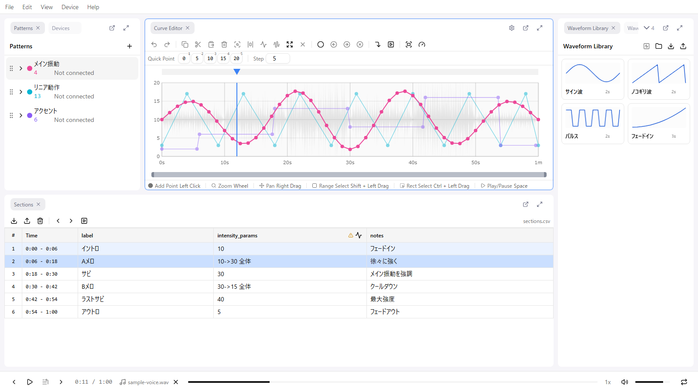
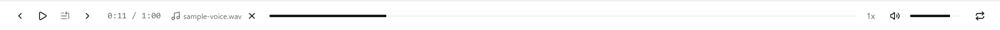

# 2. Screen Layout

The remix-editor screen is built from several **panels**. In this lesson you learn where the panels used for production are and what each one is for.

## Three areas

The screen is split into three areas from top to bottom.

| Area | Content |
|------|---------|
| Top | Menu bar (File / Edit / View / Device / Help) |
| Middle | Panel area. Almost all of the work happens here |
| Bottom | Footer (playback controls) |

## Panels used in production

There are 9 kinds of panels, but the Basics uses these 5. Learn their position in the default layout and their role.

| Panel | Default position | Role | Lesson |
|-------|------------------|------|--------|
| **Patterns** | Left | The curve for each device. Switch "which device's curve am I drawing" here | 4 |
| **Curve Editor** | Center | The main editing area for curves. The audio waveform is shown faintly in the background | 6, 7 |
| **Sections** | Bottom | Checking the transcript, notes, jumping to a scene | 5 |
| **Waveform Generator** | Right | Generate a standard waveform such as a triangle wave over a range in one go | 6 |
| **Properties** | Right | Edit the time and value of a selected point numerically | 7 |

In addition, the **Devices** panel is used when checking with a real device (lesson 8).

## When a panel is missing

- **View > Panels** has a checkbox for every panel. Bring back a closed panel here
- If the layout gets messy, **View > Layout > Reset** restores the default
- Once you are used to it, **View > Layout > Lock Layout** prevents accidentally moving panels while working

Panel layout and the lock state are saved automatically and restored the next time you open the editor.

## Footer

The footer holds play/pause, the seek slider, the time display, playback speed, volume, and loop. The next lesson covers how to use them.

## Next

[3. Playback, Seeking & Zoom](./03-playback.md)
