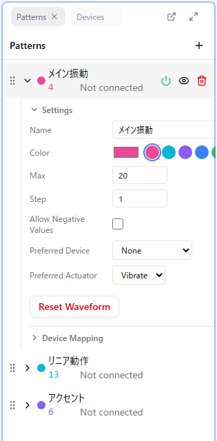

# 4. Setting Up Patterns

A **pattern** is the curve for one kind of device. A Remix is "one audio file × several patterns". Before drawing curves, create the patterns you need and finish their settings.

## Adding a pattern

1. Click the **+** button in the Patterns panel
2. A new pattern is created and becomes the selected (active) pattern

A new pattern has only two points at value 0: the start (time 0) and the end (max time). You draw the curve on top of this later.

**Only the active pattern can be edited.** Click a pattern to make it active; its name is highlighted.

## Opening the settings

Click the **▶** to the left of the pattern name to expand its settings. The Basics Course always touches these four.

### Name

Give a name that says which body part and which motion the pattern is for. You will not get lost as patterns multiply.

### Preferred device and preferred actuator (required)

Two settings that express **which body part and what kind of motion** the pattern is for. Their combination determines the pattern's device type.

| Setting | Options |
|---------|---------|
| Preferred device (body part) | Penis device / Anal device / Nipple device / Vaginal device / Clitoral device |
| Preferred actuator (motion) | Vibrate / Rotate / Linear (reciprocating motion) |

**Examples**

| Motion you want | Preferred device | Preferred actuator |
|-----------------|------------------|--------------------|
| Piston (moving a sleeve up and down) | Penis device | Linear |
| Vibration of an anal device | Anal device | Vibrate |
| Vibration of a nipple device | Nipple device | Vibrate |
| Rotation of a nipple device | Nipple device | Rotate |

::: warning Always set the preferred actuator
If any pattern has no preferred actuator, **the Remix cannot be saved**. Set it first thing after creating a pattern.
:::

### Max value

The upper limit of the pattern's values. The default is 20 and normally stays as is. The curve's vertical axis runs from 0 to the max value, and values are sent to the device converted to 0% to 100%.

### Allow negative values

When ON, the lower limit changes from 0 to "−max value". Use it on rotation devices to switch direction, as in **positive = clockwise, negative = counter-clockwise**. Leave it OFF for other patterns.

## Color

Change it with the color picker in the settings or the 8 presets next to it. When several patterns are shown on top of each other, you tell them apart by color.

## Visibility and output

Each pattern row has two switches. They are easy to confuse, so keep them apart.

| Icon | Meaning |
|------|---------|
| **Eye** | Whether the curve is drawn in the curve editor. A hidden pattern cannot be edited either |
| **Power** | Whether values are sent to the device. OFF silences that pattern |

Hiding with the eye icon does not stop output to the device. To silence a real device, turn the power OFF.

## What to do in this lesson

Create every pattern the audio needs, and set the name, preferred device, and preferred actuator on each. Turn on "Allow negative values" only for rotation-device patterns. [Lesson 10](./10-by-device.md) summarizes which patterns are typically needed.

## Next

[5. Reading Sections](./05-sections.md)
