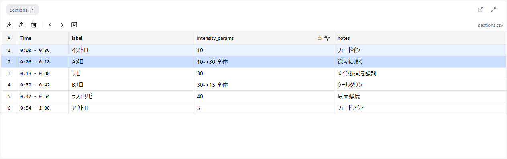

# 5. Reading Sections

**Section data** divides the audio into ranges (start time to end time), each with a transcript, notes, and so on. It is the "script" for making a Remix. In this lesson you learn to **read sections, jump to scenes, and leave notes**.

## Where sections come from

- When opened from the CMS, the chapter's section data is already loaded
- To provide it yourself, load a CSV via **File > Import Section Data...** (the CSV format is in the [Reference](../08-sections.md#csv-file-format))

Once loaded, sections appear as a table in the Sections panel, and their boundaries also appear on the curve editor's time axis.

## Reading the table

One row is one section. The columns are whatever the CSV contained. Common ones:

| Column | Content |
|--------|---------|
| Start / End | The range's time in seconds |
| text | Transcript of the audio. It is generated automatically, so some parts are misheard |
| Note-type columns | Per-range remarks, or your own notes about the intended motion |

Where there is a gap between sections, a gray "gap section" is inserted automatically. It is read-only.

## Click a row to jump to the scene

Clicking a row does two things at once:

1. The **selection** in the curve editor becomes that section's time range
2. The **playback position** moves to the start of that section

So when you want to work on a scene's curve, one click on the row selects the range and cues it up. Lesson 6, "Laying down waveforms", starts from this state.

**Shift + click** selects several sections together.

## Moving with the keyboard

| Key | Action |
|-----|--------|
| ← / → | Previous / next section |
| Shift + ← / → | Extend the selection to the previous / next section |

Keyboard moves change only the selection; the playback position stays. To move playback too, click the row or use the ◀ ▶ buttons in the Sections panel or the footer.

## Follow the table during playback

Turn on **Auto-scroll** in the Sections panel toolbar and the row for the scene being played stays in view. Use it while listening through the audio and following the transcript.

## Writing notes

Click a cell to edit it in place. Marks for where motion starts and ends, special scenes such as countdowns or chants, and decisions you made are all worth noting for later.

- Single-line cell: **Enter** confirms
- Multi-line cell: **Enter** adds a line, **Ctrl + Enter** confirms
- **Escape** cancels. Clicking outside the cell also saves

## What to do in this lesson

Listen through the audio once while following the transcript. Note misheard passages, where motion begins, and the climax in a note column. Getting the whole picture here makes lessons 6 onward faster.

## Next

[6. Laying Down Waveforms](./06-generate.md)
