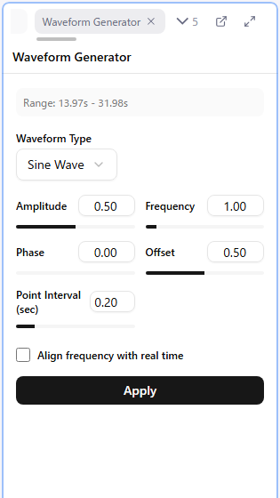

# 6. Laying Down Waveforms

You can build a curve one point at a time, but for the strokes in an action scene it is far faster and more consistent to **lay a standard waveform over the range and then fix it by hand**. In this lesson you lay down a triangle wave with the Waveform Generator panel.

## Steps

1. Make the target pattern active (click it in the Patterns panel)
2. Select a time range in the curve editor. **Clicking a row in the Sections panel** makes that scene the range. To select by hand, **Shift + drag**
3. Press **W** (or right-click > Generate Waveform...) to open the Waveform Generator panel
4. Choose **Triangle** as the waveform type and press "Generate". A preview appears on the canvas
5. Change parameters and the preview updates live
6. When the shape is right, press **Apply**. "Cancel" discards it

Nothing is generated without a time range. Remember it as "select a range, then W".

## Three parameters to learn

For a triangle wave, learn these three first. Knowing what each maps to on the curve lets you get the shape you want quickly.

| Parameter | Meaning on the curve |
|-----------|----------------------|
| **Amplitude** | Height of the wave = depth of the motion (stroke length) |
| **Frequency** | Number of waves = speed of the motion |
| **Offset** | Vertical position of the whole wave = height of the motion's center |

Checking "Match frequency to real time" makes frequency mean "waves per second" instead of "waves within the range". **Keep it checked when you want to set the speed in real time, such as one stroke per second**; the speed then stays the same even when the range length changes.

Triangle waves also have a "peak position" that changes the ratio of rise to fall. Leave it at the default at first.

## What happens on Apply

- Existing points inside the range are removed and replaced by the generated ones (the start and end points remain)
- Values are snapped to the pattern's step and clamped to 0 to max value
- The apply is one Undo step. If you do not like it, **Ctrl + Z** reverts the whole thing
- After applying, the generated points are selected, ready for "resizing the selection" in the next lesson

## Other waveform types

Sine, square, random, and triangle (slope) are available. Square is an ON / OFF pulse; triangle (slope) sets speed as "how many value units per second". See the [Reference on waveform generation](../09-waveform-generation.md) for when to use each. The Basics Course only needs triangle waves.

## What to do in this lesson

Click the sections you noted in lesson 5 as "scenes with motion" one by one and lay a triangle wave over each. Vary amplitude, frequency, and offset per scene and confirm that the depth, speed, and height of the motion visibly differ.

## Next

[7. Adjusting by Hand](./07-adjust.md)
