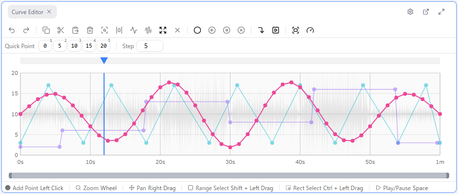
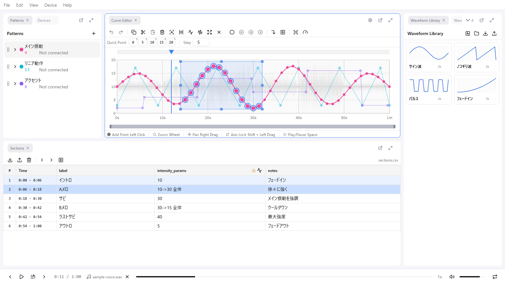
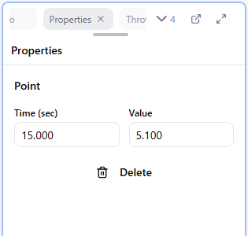

# 7. Adjusting by Hand

A freshly generated waveform usually has its start and end out of sync with the audio, or is flat where you want the intensity to change within a scene. In this lesson you learn to **place, move, and delete** points, **reshape** a range at once, and align **precisely with numbers**.

A curve is a series of points that have only a time and a value, and points are always joined by straight lines. There are no curve types or interpolation settings.

## Handling points one at a time

| Action | How |
|--------|-----|
| Place | **Left-click** an empty spot. The new point stays grabbed, so drag without releasing to position it |
| Move | **Drag** the point. Holding **Shift** locks the axis (time or value) to the direction you started moving |
| Delete | Select the point and press **Delete** |
| Select | Click the point. **Ctrl + click** adds to the selection |

The start point (time 0) and end point (max time) can only change value; their time is fixed and they cannot be deleted.

## Handling a range at once

### Selecting

- **Shift + drag**: select by time range (all values)
- **Ctrl + drag**: select by rectangle
- **Ctrl + A**: select all / **Escape**: clear the selection

### Moving together

Grab any selected point and drag, and every selected point moves with it.

### Resizing the selection

Drag the handles on the selection frame to reshape all points inside at once. Adjustments such as **opening up the depth or height only in the second half of a scene** are done this way.

| Handle | Action |
|--------|--------|
| Top / bottom edge | Move the upper / lower values (slopes are kept) |
| Left / right edge | Move the start / end of the time range |
| Corners | Move only that corner (trapezoid; makes "gradually deeper") |
| **Alt** + edge | Symmetric resize: the opposite edge moves the other way |

### Copy and repeat

| Key | Action |
|-----|--------|
| Ctrl + C | Copy the selected points |
| Ctrl + V | Paste relative to the **current playback position** |

To reuse the same rhythm in the next scene, select and copy the previous scene, move the playhead to the start of the next scene, and paste. Existing points at the destination are overwritten.

## Aligning precisely with numbers

Select a single point and the **Properties** panel shows "Time (s)" and "Value" fields. When you want the start of a motion aligned to the audio within 0.1 seconds, type the number here instead of dragging.

## Undo

- **Ctrl + Z**: undo
- **Ctrl + Shift + Z**: redo

Curve edits, section edits, and waveform generation all share one history. When in doubt, undo and try again.

## Placing while playing (quick placement)

The **quick placement bar** at the top of the curve editor lets you press **number keys 1 to 9** during playback to place a point with a fixed value at that instant. It is handy for tapping along with chants or counts. If the timing of the placed points is uneven, select the range and press **E** to space them evenly.

## What to do in this lesson

Fix these three things in the waveforms from lesson 6:

1. Align the first and last points of each motion to the audio (type the numbers in Properties)
2. Open up the depth in the second half of a scene with a selection resize
3. Join scenes with the same rhythm by copy and paste

## Next

[8. Previewing](./08-preview.md)
