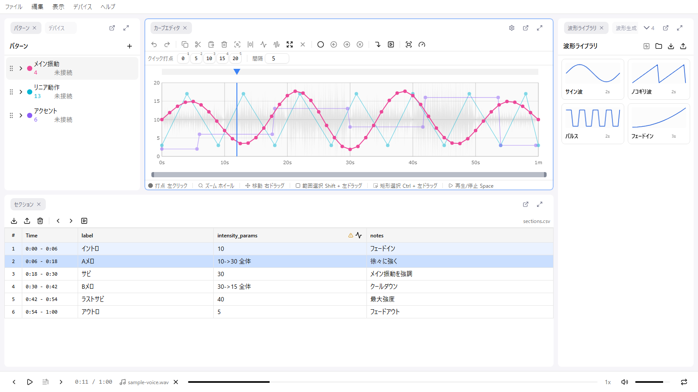

# 2. 画面の見取り図

remix-editor の画面は、複数の **パネル** を並べた作りになっています。この回では、制作で使うパネルがどこにあって、何をする場所かを覚えます。

## 3 つの帯

画面は上から 3 つの帯に分かれています。

| 帯 | 内容 |
|----|------|
| 上 | メニューバー（ファイル / 編集 / 表示 / デバイス / ヘルプ） |
| 中央 | パネルエリア。制作のほとんどはここで行います |
| 下 | フッター（再生コントロール） |

## 制作で使うパネル

パネルは 9 種類ありますが、基礎講座で使うのは次の 5 つです。既定のレイアウトでの位置と役割を押さえてください。

| パネル | 既定の位置 | 役割 | 使う回 |
|--------|-----------|------|--------|
| **パターン** | 左 | デバイスごとのカーブの置き場。「いまどのデバイスのカーブを描いているか」をここで切り替えます | 4 |
| **カーブエディタ** | 中央 | カーブを描く主戦場。背景に音声の波形が薄く出ます | 6, 7 |
| **セクション** | 下 | 文字起こしの確認・メモ・場面へのジャンプ | 5 |
| **波形生成** | 右 | 三角波などの定型波形を範囲にまとめて敷く | 6 |
| **プロパティ** | 右 | 選んだ点の時間と値を数値で直す | 7 |

このほか、実機をつないで確かめるときに **デバイス** パネルを使います（8 回目）。

## パネルが見当たらないとき

- **表示 > パネル** に全パネルのチェックボックスがあります。閉じてしまったパネルはここで戻せます
- レイアウトが崩れたら **表示 > レイアウト > リセット** で既定に戻ります
- 慣れてきたら **表示 > レイアウト > レイアウトをロック** で固定しておくと、作業中に誤ってパネルを動かす事故を防げます

パネルの配置とロック状態は自動保存され、次回開いたときも同じ状態で開きます。

## フッター

フッターには再生・一時停止、シークスライダー、時間表示、再生速度、音量、ループが並びます。使い方は次の回でまとめて扱います。

## 次へ

[3. 再生と移動、ズーム](./03-playback.md)
