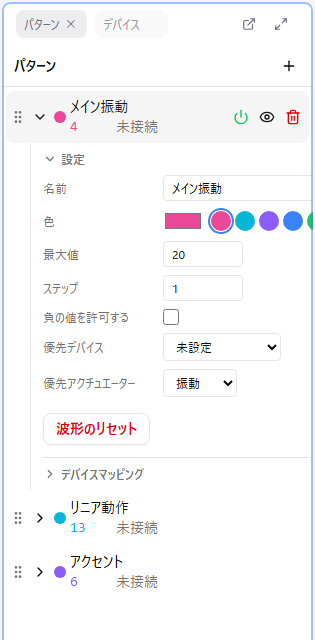

# 4. パターンを用意する

**パターン** は、デバイス 1 種類分のカーブです。Remix は「音声 1 本 × パターン数本」でできています。カーブを描く前に、必要なパターンを用意して設定を済ませます。

## パターンを追加する

1. パターンパネルの **+** ボタンをクリックします
2. 新しいパターンが作られ、そのまま選択（アクティブ）になります

新しいパターンには、始点（時間 0）と終点（最大時間）の 2 点だけが値 0 で置かれています。ここに後からカーブを描いていきます。

**編集できるのはアクティブなパターンだけ** です。パターンをクリックすると、そのパターンがアクティブになり、パターン名が強調表示されます。

## 設定を開く

パターン名の左の **▶** をクリックすると、設定欄が展開します。基礎講座で必ず触るのは次の 4 つです。

### 名前

「どの部位の、どの動きのためのパターンか」が分かる名前を付けます。パターンが増えたときに迷わなくなります。

### 優先デバイスと優先アクチュエーター（必須）

パターンが **どの部位の、どんな種類の動き** を想定しているかを表す 2 つの設定です。この掛け合わせが、そのパターンのデバイスタイプを決めます。

| 設定 | 選択肢 |
|------|--------|
| 優先デバイス（部位） | ペニスデバイス / アナルデバイス / ニップルデバイス / 膣内デバイス / クリトリスデバイス |
| 優先アクチュエーター（動き） | 振動（Vibrate）/ 回転（Rotate）/ リニア（Linear、往復運動） |

**例**

| 作りたい動き | 優先デバイス | 優先アクチュエーター |
|--------------|-------------|---------------------|
| ピストン（オナホを上下させる） | ペニスデバイス | リニア |
| アナル用デバイスの振動 | アナルデバイス | 振動 |
| 乳首用デバイスの振動 | ニップルデバイス | 振動 |
| 乳首用デバイスの回転 | ニップルデバイス | 回転 |

::: warning 優先アクチュエーターは必ず設定する
優先アクチュエーターが未設定のパターンがあると、**Remix を保存できません**。パターンを作ったら最初に設定してください。
:::

### 最大値

パターンの値の上限です。既定は 20 で、通常はそのままで構いません。カーブの縦軸は 0 〜 最大値になり、デバイスには 0% 〜 100% に換算して送られます。

### 負の値を許可する

ON にすると、値の下限が 0 から「−最大値」になります。回転デバイスで **正の値 = 右回転、負の値 = 左回転** のように向きを切り替えたいときに使います。それ以外のパターンでは OFF のままにします。

## 色

設定欄のカラーピッカー、または横に並んだ 8 色のプリセットで変えられます。複数のパターンを重ねて表示したとき、色で見分けます。

## 表示と出力

パターンの行には 2 つのスイッチがあります。混同しやすいので区別してください。

| アイコン | 意味 |
|----------|------|
| **目** | カーブエディタに描くかどうか。非表示のパターンは編集もできません |
| **電源** | デバイスへ値を送るかどうか。OFF にするとそのパターンは黙ります |

目のアイコンで非表示にしても、デバイスへの出力は止まりません。実機を黙らせたいときは電源を OFF にします。

## この回でやること

音声に対して必要なパターンを全部作り、名前・優先デバイス・優先アクチュエーターを設定してください。回転デバイス用のパターンだけ「負の値を許可する」を ON にします。どのパターンが必要かの目安は [10 回目](./10-by-device.md) にまとめてあります。

## 次へ

[5. セクションを読む](./05-sections.md)
