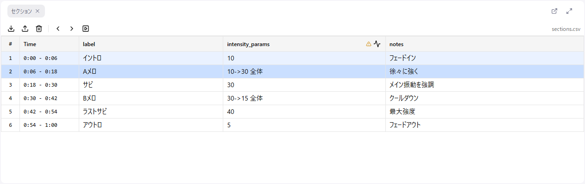

# 5. セクションを読む

**セクションデータ** は、音声を区間（開始時間〜終了時間）に区切って、それぞれに文字起こしやメモを付けたものです。Remix を作るとき、どの場面で何が起きているかを知る手がかりになります。この回では、セクションを **読んで、場面へ飛んで、メモを残す** 使い方を覚えます。

## セクションはどこから来るか

- CMS から開いた場合は、対象の章のセクションデータが読み込み済みです
- 自分で用意する場合は、**ファイル > セクションデータをインポート...** から CSV を読み込みます（CSV の形式は[リファレンス](../08-sections.md#csv-ファイル形式)）

セクションが読み込まれると、セクションパネルに表として並び、カーブエディタの時間軸にも区切りが出ます。

## 表の見方

1 行が 1 セクションです。列は CSV に含まれていたものがそのまま出ます。よくある列は次のとおりです。

| 列 | 内容 |
|----|------|
| 開始 / 終了 | その区間の時間（秒） |
| text | 音声の文字起こし。自動生成なので、聞き取りが不正確な箇所があります |
| メモ系の列 | 区間ごとの補足や、動作の方針の書き残し |

セクションとセクションの間に空白があると、灰色の「ギャップセクション」が自動で挟まります。読むだけの行で、編集はできません。

## 行をクリックして場面へ飛ぶ

行をクリックすると、次の 2 つが同時に起きます。

1. カーブエディタの **選択範囲** がそのセクションの時間範囲になる
2. **再生位置** がそのセクションの先頭へ移動する

つまり「この場面のカーブを作りたい」と思ったら、行をクリックするだけで、範囲の選択と頭出しが済みます。6 回目の「波形を生成する」はこの状態から始めます。

**Shift + クリック** で複数のセクションをまとめて選べます。

## キーボードで前後へ

| キー | 動作 |
|------|------|
| ← / → | 前 / 次のセクションへ |
| Shift + ← / → | 選択範囲を前 / 次のセクションまで広げる |

キーボードで動かしたときは選択だけが変わり、再生位置は動きません。再生位置も一緒に動かしたいときは、行をクリックするか、セクションパネルやフッターの ◀ ▶ ボタンを使います。

## 再生に合わせて表を追いかける

セクションパネルのツールバーで **自動スクロール** を ON にすると、再生中の場面の行が常に見える位置に保たれます。文字起こしを目で追いながら音声を通しで聞くときに使います。

## メモを書く

セルをクリックすると、その場で編集できます。動き始め・動き終わりの目印、カウントダウンや掛け声などの特殊な場面、自分で決めた方針などを書き残しておくと、後で見返すときに役立ちます。

- 1 行のセル: **Enter** で確定
- 複数行のセル: **Enter** で改行、**Ctrl + Enter** で確定
- **Escape** で取り消し。セルの外をクリックしても保存されます

## この回でやること

音声を通しで 1 回聞きながら、セクションの文字起こしを目で追ってください。聞き取りが違う箇所、動きが始まる場面、山場になる場面をメモの列に書き残します。ここで音声の全体像をつかんでおくと、6 回目以降が速くなります。

## 次へ

[6. 波形を生成する](./06-generate.md)
