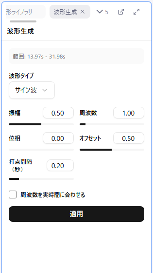

# 6. 波形を生成する

カーブは、点を 1 つずつ手で打っても作れますが、行為の区間のストロークは **定型の波形を範囲にまとめて生成してから手で直す** ほうが圧倒的に速く、形も揃います。この回では波形生成パネルで三角波を生成します。

## 手順

1. 波形を生成したいパターンをアクティブにします（パターンパネルでクリック）
2. カーブエディタで時間範囲を選択します。**セクションパネルの行をクリック** すると、その場面がそのまま範囲になります。手で選ぶときは **Shift + ドラッグ** です
3. **W** キーを押す（または右クリック > 波形を生成...）と、波形生成パネルが開きます
4. 波形タイプで **三角波** を選び、「波形生成」ボタンを押します。キャンバス上にプレビューが出ます
5. パラメータを動かすと、プレビューがその場で更新されます
6. 形が決まったら **適用** を押します。やめるときは「キャンセル」です

時間範囲を選んでいないと生成できません。「範囲を選んでから W」と覚えてください。

## 覚えるパラメータは 3 つ

三角波で最初に覚えるのは次の 3 つです。それぞれがカーブの何に対応するかを押さえると、狙った形をすぐ出せます。

| パラメータ | カーブでの意味 |
|------------|----------------|
| **振幅** | 波の高さ = 動きの深さ（ストロークの幅） |
| **周波数** | 波の数 = 動きの速さ |
| **オフセット** | 波全体の上下位置 = 動きの中心の高さ |

「周波数を実時間に合わせる」にチェックを入れると、周波数が「範囲内の波の数」ではなく「1 秒あたりの波の数」になります。**「1 秒に 1 往復」のように速さを実時間で決めたいときはチェックを入れておく** と、範囲の長さが変わっても同じ速さで生成できます。

三角波には「ピーク位置」もあり、上りと下りの長さの比を変えられます。最初は既定のままで構いません。

## 適用したときに起きること

- 範囲内にあった既存の点は消えて、生成した点に置き換わります（始点と終点は残ります）
- 値はパターンのステップに揃えられ、0 〜 最大値の範囲に収められます
- 適用は Undo 1 回分です。気に入らなければ **Ctrl + Z** で丸ごと戻せます
- 適用後、生成された点が選択された状態になります。そのまま次の回の「選択範囲のリサイズ」で形を整えられます

## ほかの波形タイプ

サイン波・矩形波・ランダム波・三角波（傾き）があります。矩形波は ON / OFF のパルス、三角波（傾き）は「1 秒あたりに何値動くか」で速さを指定するタイプです。使い分けは[リファレンスの波形生成](../09-waveform-generation.md)を参照してください。基礎講座では三角波だけ使えれば足ります。

## この回でやること

5 回目でメモした「動きがある場面」のセクションを順にクリックし、それぞれに三角波を生成してください。場面ごとに振幅・周波数・オフセットを変えて、動きの深さ・速さ・高さが違って見えることを確認します。

## 次へ

[7. 手で調整する](./07-adjust.md)
