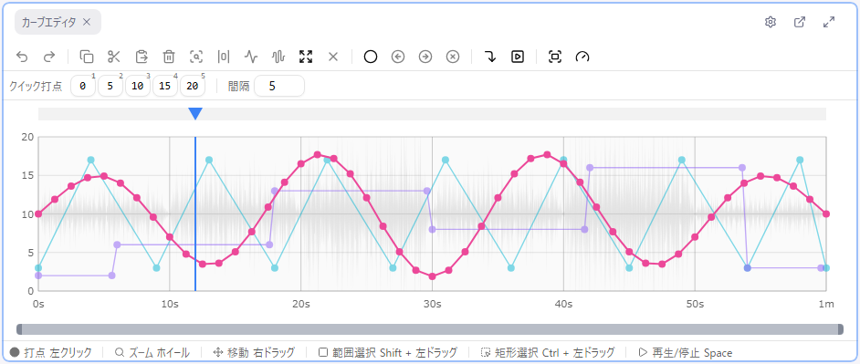
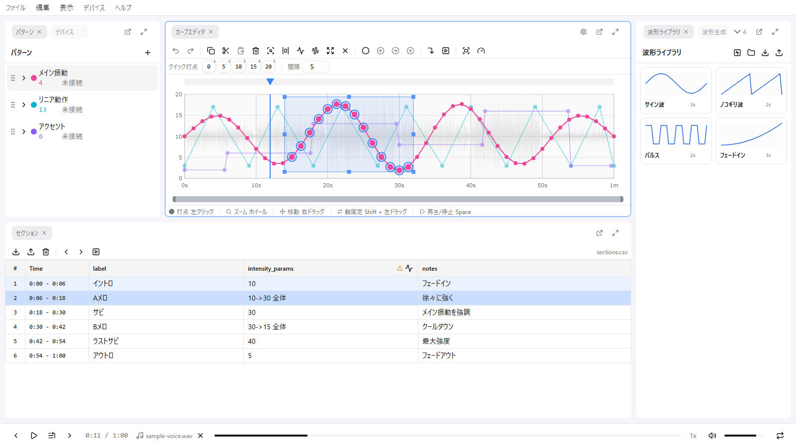
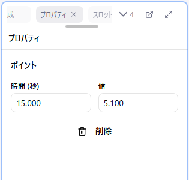

# 7. 手で調整する

波形を生成しただけでは、動き始めや動き終わりが音声とずれていたり、場面の中で強弱を付けたい箇所が平坦だったりします。この回では、点を **打つ・動かす・消す**、範囲を **まとめて変形する**、数値で **正確に合わせる** 操作を覚えます。

カーブは「時間」と「値」だけを持つ点の並びで、点と点の間は必ず直線でつながります。曲線の種類や補間の設定はありません。

## 点を 1 つずつ扱う

| 操作 | 方法 |
|------|------|
| 打つ | 空いているところを **左クリック**。打った点はそのまま掴んでいるので、離さずドラッグして位置を決められます |
| 動かす | 点を **ドラッグ**。**Shift** を押しながらだと、動き始めた方向（時間か値か）に軸が固定されます |
| 消す | 点を選んで **Delete** |
| 選ぶ | 点をクリック。**Ctrl + クリック** で選択に追加 |

始点（時間 0）と終点（最大時間）は値だけ変えられ、時間は動かせず、削除もできません。

## 範囲をまとめて扱う

### 選ぶ

- **Shift + ドラッグ**: 時間範囲で選ぶ（値方向は全部）
- **Ctrl + ドラッグ**: 矩形で選ぶ
- **Ctrl + A**: 全部選ぶ / **Escape**: 選択を解除

### まとめて動かす

選択中の点のどれかを掴んでドラッグすると、選択した点が全部一緒に動きます。

### 選択範囲のリサイズ

選択範囲の枠に出るハンドルをドラッグすると、範囲内の点をまとめて変形できます。生成した三角波の **深さや高さを場面の後半だけ変える** ような調整はこれでやります。

| ハンドル | 動作 |
|----------|------|
| 上辺 / 下辺 | 上端 / 下端の値を動かす（傾きは維持） |
| 左辺 / 右辺 | 時間範囲の開始 / 終了を動かす |
| 四隅 | その隅だけを動かす（台形に変形。「だんだん深く」を作れます） |
| **Alt** + 辺 | 反対側の辺も逆方向に動く対称リサイズ |

### コピーして繰り返す

| キー | 動作 |
|------|------|
| Ctrl + C | 選択した点をコピー |
| Ctrl + V | **現在の再生位置** を基準に貼り付け |

同じリズムを次の場面にも使いたいときは、前の場面を選んでコピーし、再生位置を次の場面の頭に合わせて貼り付けます。貼り付け先に点があると上書きされます。

## 数値で正確に合わせる

点を 1 つ選ぶと、**プロパティ** パネルに「時間 (秒)」と「値」の入力欄が出ます。動き始めを音声の位置に 0.1 秒単位で合わせたいときは、ドラッグではなくここで数値を打ちます。

## やり直す

- **Ctrl + Z**: 元に戻す
- **Ctrl + Shift + Z**: やり直す

カーブの編集だけでなく、セクションの編集や波形生成もすべて同じ履歴に積まれます。迷ったら戻してやり直してください。

## 再生しながら打つ（クイック打点）

カーブエディタ上部の **クイック打点バー** を使うと、再生しながら **数字キー 1〜9** で、その瞬間の再生位置に決まった値の点を打てます。掛け声やカウントに合わせてリズムで打ちたいときに便利です。打った点のタイミングが揃っていないときは、範囲を選んで **E** キーを押すと等間隔に並び直せます。

## この回でやること

6 回目で生成した波形について、次の 3 つを直してください。

1. 動き始めと動き終わりの点を、音声の位置に合わせる（プロパティで数値を打つ）
2. 場面の後半だけ、選択範囲のリサイズで深さを開く
3. 同じリズムが続く場面はコピー＆ペーストでつなぐ

## 次へ

[8. プレビューする](./08-preview.md)
